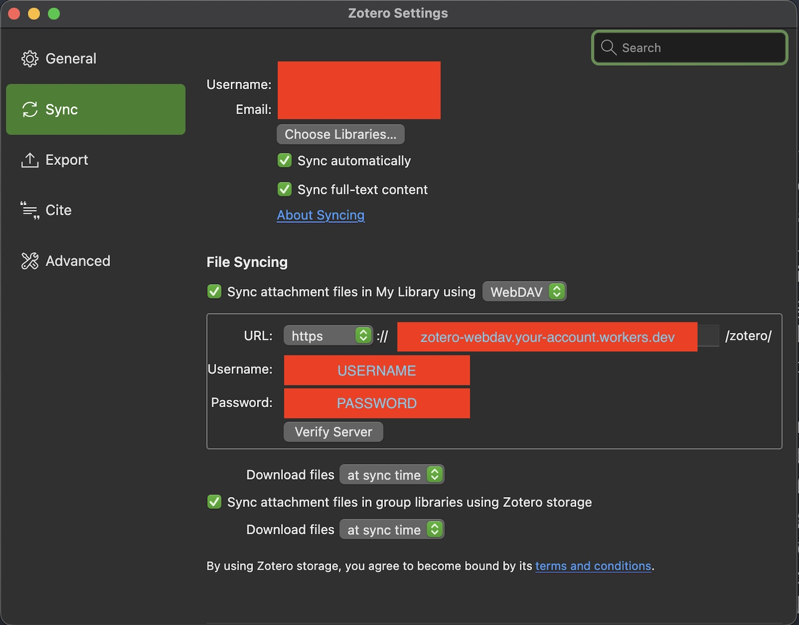

# zotero-webdav

Sync your Zotero attachments to your own Cloudflare R2 bucket instead of
paying for [Zotero Storage](https://www.zotero.org/storage). A typical
library fits in R2's free tier (10 GB), and even 100 GB costs ~$1.50/month
with zero egress fees.

This is a minimal WebDAV server running on a Cloudflare Worker, implementing
exactly the subset of [RFC 4918](https://datatracker.ietf.org/doc/html/rfc4918)
that [Zotero file syncing](https://www.zotero.org/support/sync#alternative_syncing_solutions)
uses: `OPTIONS`, `PROPFIND` (Depth 0/1), `MKCOL`, `HEAD`, `GET`, `PUT`,
`DELETE`, behind HTTP Basic auth.

## Deploy your own

[](https://deploy.workers.cloudflare.com/?url=https://github.com/a10y/zotero-webdav)

1. Click the button. Cloudflare clones this repo into your GitHub/GitLab
   account, creates the R2 bucket, and deploys the Worker. A free Cloudflare
   account works, but R2 must be enabled on it (requires a payment method on
   file, even for free-tier usage).
2. Set your WebDAV credentials — pick any username and a strong password. In
   the Cloudflare dashboard, open the Worker → **Settings → Variables and
   Secrets** and add `WEBDAV_USERNAME` and `WEBDAV_PASSWORD` as secrets (or
   run `npx wrangler secret put <NAME>` from your clone). Until these are
   set, the Worker responds with setup instructions instead of serving files.
3. Point Zotero at it (see below).

### Or deploy from the command line

```sh
git clone https://github.com/a10y/zotero-webdav && cd zotero-webdav
npm install
npx wrangler login
npx wrangler r2 bucket create zotero-attachments
npx wrangler secret put WEBDAV_USERNAME
npx wrangler secret put WEBDAV_PASSWORD
npx wrangler deploy
```

## Configure Zotero

On each device, in **Settings → Sync → File Syncing**, set "Sync attachment
files in My Library using" to **WebDAV**:

- URL: `https://zotero-webdav.<your-subdomain>.workers.dev/` (Zotero appends
  `zotero/` itself)
- Username / password: the secrets you set above

Click **Verify Server**.



## How it works

Zotero stores each attachment flat under `/zotero/` as `<itemKey>.zip` plus a
small `<itemKey>.prop` metadata file. These map 1:1 to R2 object keys. R2 has
no real directories, so collections are implicit: `PROPFIND` on any
trailing-slash path reports an existing collection and `MKCOL` is a no-op
success. Zotero's "purge orphaned files" works too — Depth-1 `PROPFIND`
paginates the full bucket listing.

## Local development

```sh
cp .dev.vars.example .dev.vars   # local-only credentials
npm run dev                      # local server with simulated R2
```

## Notes & limits

- Workers caps request bodies (~100–500 MB depending on plan tier), which
  bounds the largest single attachment you can upload. Typical PDFs are
  nowhere close.
- Anyone with the URL can attempt Basic auth, so use a strong password;
  credentials are compared in constant time.

## License

[MIT](LICENSE)
